<p align="center">
  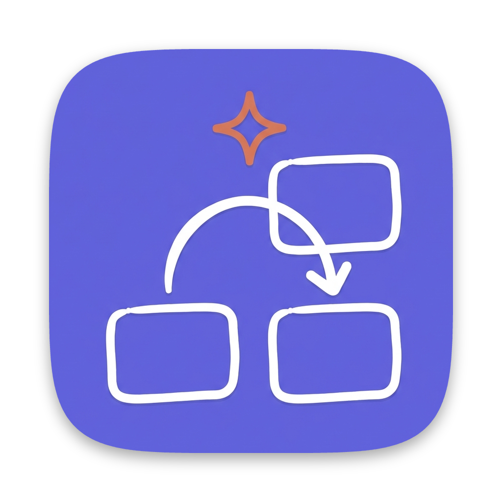
</p>

# AI Whiteboard

**Excalidraw whiteboards that your coding agents can read and draw on.**

AI Whiteboard is a desktop app that puts [Excalidraw](https://excalidraw.com) boards and coding-agent
chats in one window. Claude Code, Cursor and pi work on the board with you: select a few shapes
and ask "explain this", or ask for "the request flow between these services", and the agent draws
it on the board while you watch. It runs on your own machine, with the agent logins you already
have, and keeps all three agents in one place.

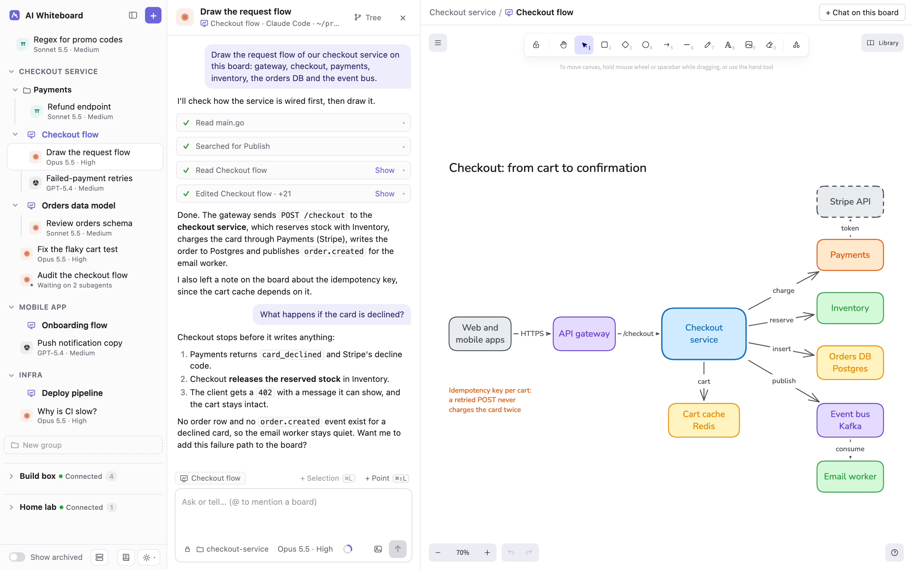

## What you can do with it

### Work on a board together with an agent

Every whiteboard has its own chats, and the agent of such a chat has tools for the board.

- **It reads what you drew.** The agent gets the board as text (shapes, labels, what each arrow
  connects) and can ask for a picture of it, to see colours, layout and overlaps.
- **It knows what you are looking at.** It can see which board is on screen, the visible area and
  your selection. Press ⌘L to put the selected shapes into your message, or ⌘⇧L and click to
  point at a spot on the board.
- **It draws directly on the board.** New and changed elements appear as the agent works,
  marked with the agent's name. Each change it makes is one undo step, so ⌘Z takes it back.
- **It works across boards.** Mention another board with `@` to bring it into the message. When
  you ask for it, an agent creates a new board or brings a board to your screen.

You keep drawing while the agent works, and a pill on the board says which agent is working on it.

### Chat with Claude Code, Cursor and pi

A chat belongs to a whiteboard or stands alone: a plain chat is a coding-agent chat without a
board. Either way you pick the agent, its model, the effort, and the folder it works in, per chat.

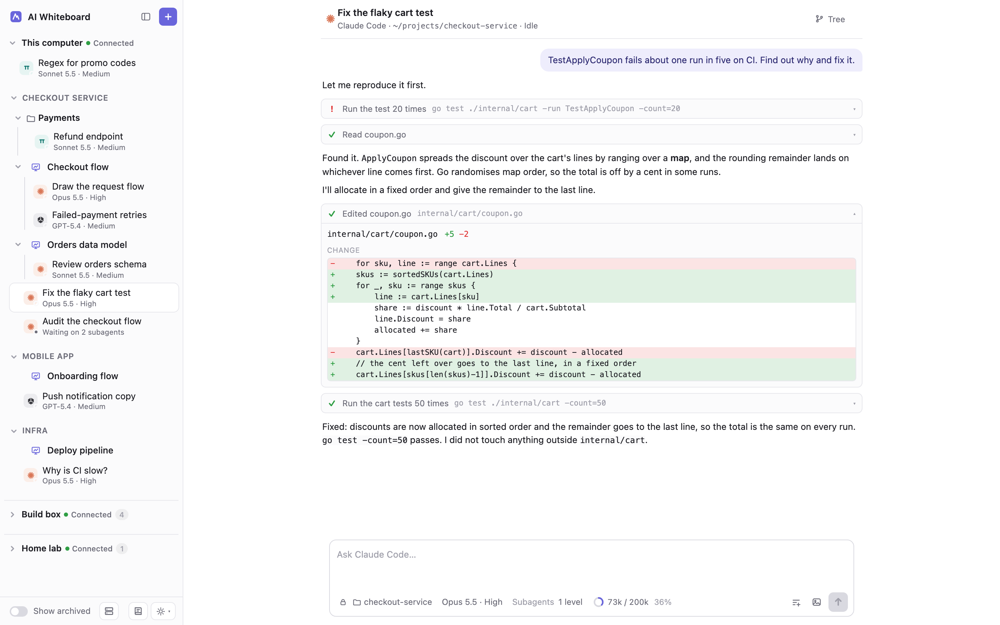

- **Tool calls are cards** in the thread, with the command or the diff of the edit. When an agent
  asks for permission, the request is a card you answer with **Allow** or **Don't**.
- **Images in a message.** Paste an image or attach a file (PNG, JPEG, GIF, WebP) and the agent
  gets it with your text.
- **Quote and comment.** Select a passage of an answer, press ⌘L, and write your comment on
  exactly that passage. A message can carry several.
- **Context and plan usage.** A ring in the composer shows how full the context window is. A
  click splits it by category and, for Claude Code and Cursor, shows your plan's usage limits.
- **Several chats at once.** Chats keep working while you look at another one. The sidebar marks
  the ones that are working, and drafts of unsent messages are kept.

<p>
  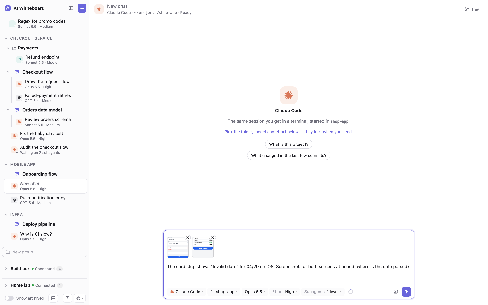
  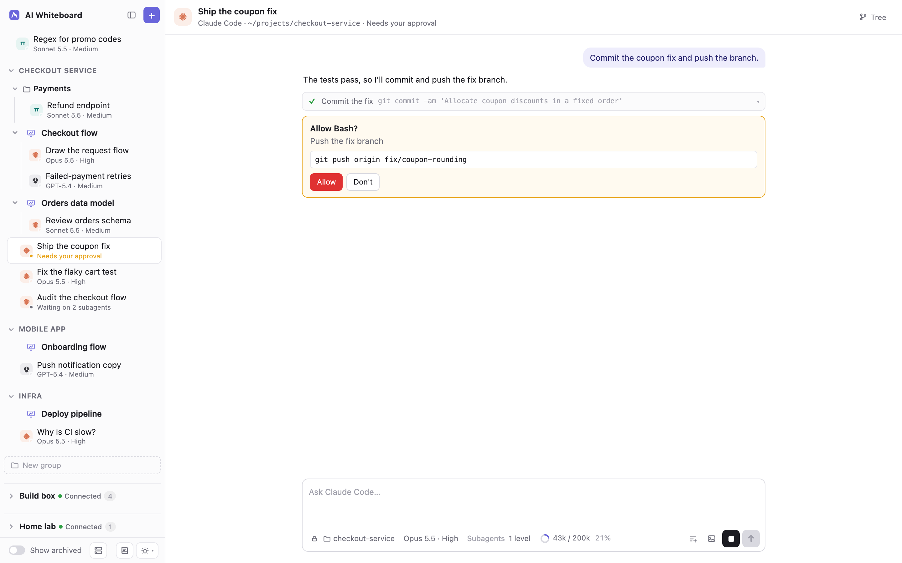
</p>

### Branch and fork a chat

A chat is a tree, not a line. From any message you can **Branch** (continue from that point on a
new branch, the old one stays), **Branch and edit** (the same, with the message back in the
composer to change), or **Fork to new** (copy the chat up to there into a new chat). The chat
tree (⌘⇧B) shows every branch and fork, can be searched, and lets you label messages as
bookmarks. Branches of one chat can work at the same time.

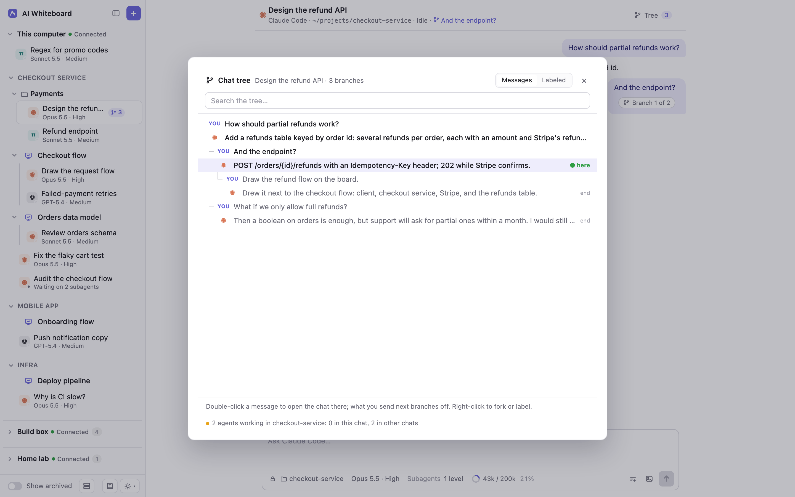

### Let an agent hand work to subagents

An agent can start subagents and carry on when their results come back. A subagent can be another
agent or another model than the chat's own, so a Claude Code chat can hand a task to Cursor or pi.

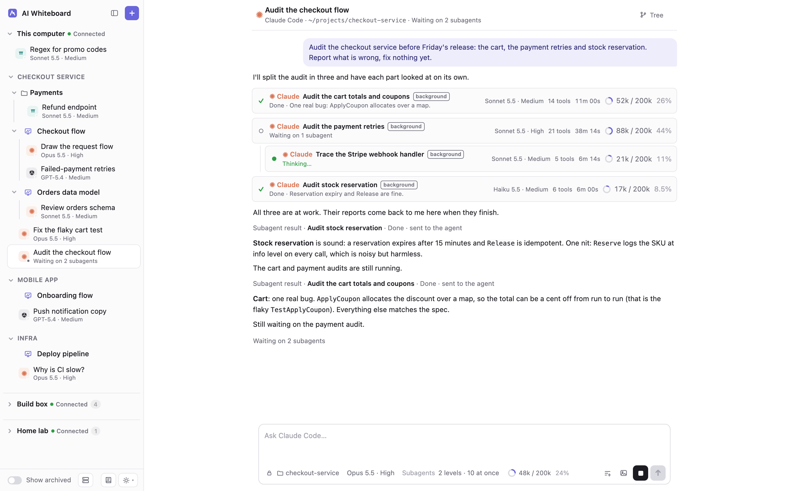

Each subagent is a row in the thread that shows what it is doing; a click opens its own thread.
Before the first message you set two limits for the chat: the **depth** (off, or one to three
levels of subagents starting subagents) and how many may **run at once** (up to 100).

### Keep your prompts in a library

The prompt library holds the texts you type often, in nested groups. In any chat, ⌘P opens a
search over the library and Enter inserts the prompt at the cursor, as plain text you can edit.

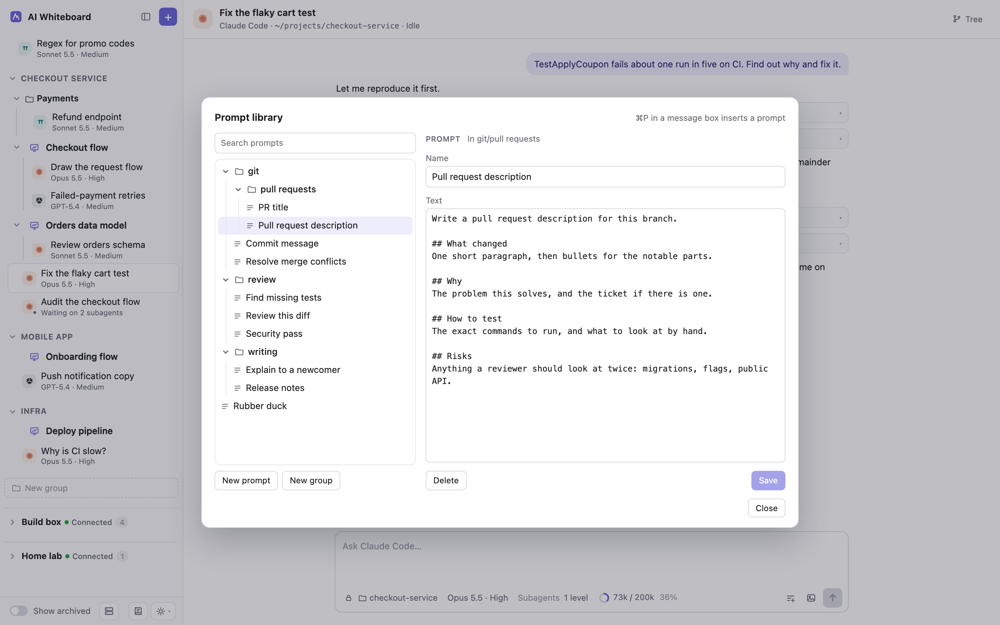

### Run agents on another machine

The app is the client of every AI Whiteboard server, the one on your own computer included. Your
computer is the first section of the sidebar, and a server on another computer, a workstation, a
build machine, a box with the repositories on it, is a section below it. Each section has its
groups, whiteboards and chats, and all of them behave alike. What you make in a section runs on
that machine, with its agents and folders, and you draw on its boards from your own window. When
a server is down, its section says so and the others keep working.

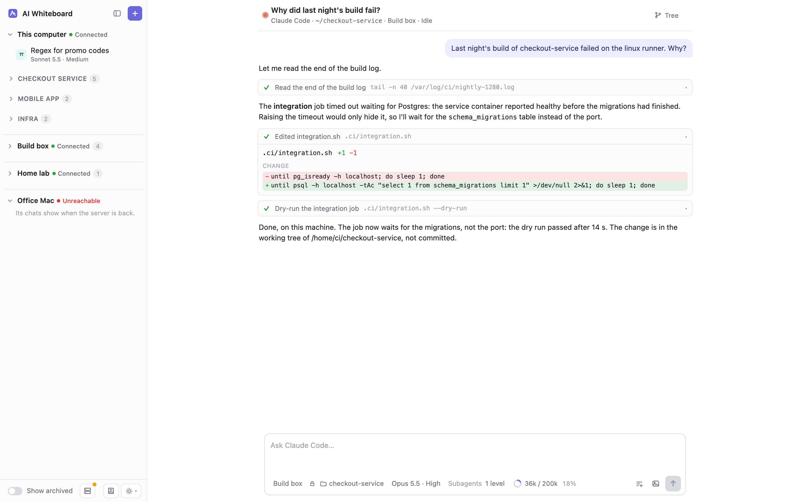

Servers are meant for a private network or a VPN, not for the open internet: the secret that
connects an app gives access to everything on that server. Set-up is in
[docs/remote-servers.md](docs/remote-servers.md).

### Stay organised, and stay local

- **Groups and archive.** Sort whiteboards and chats into nested groups by drag and drop. Archive
  what is done: it becomes read-only and leaves the sidebar until you switch on **Show archived**.
- **Your data stays on your disk.** Boards and chats are files in `~/.ai-whiteboard`; a board is
  an ordinary `.excalidraw` file. There is no account and no cloud service of the app's own.
  Agents run through their own CLIs, with the logins and plans you already have.
- **A desktop app.** On macOS the app is an Electron window. The server runs on its own:
  quitting the app does not stop it or the chats that are working; open the app again and they
  are there. There is no page to open in a browser tab.
- **Themes.** Light, dark, follow the system, or one of the four Catppuccin flavours. The board's
  canvas follows the theme too, and the board file does not change.

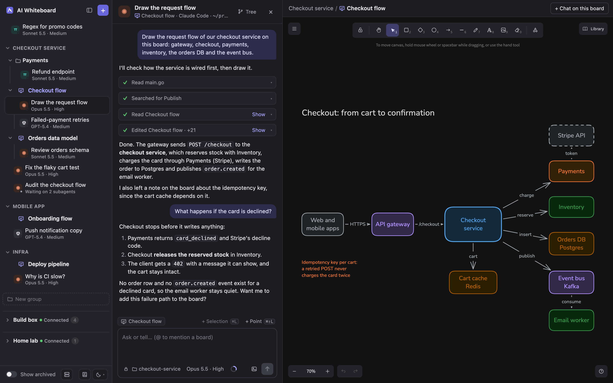

| Shortcut | What it does |
| --- | --- |
| ⌘L | Put the board's selection, or the text selected in an answer, into the message |
| ⌘⇧L | Click a point on the board to put it into the message |
| ⌘P | Insert a prompt from the library |
| ⌘⇧B | Open the chat tree |
| ⌘J | Show or hide the chat beside the board |
| ⌘B | Show or hide the sidebar |
| ⌘N | New chat |
| Esc | Stop the agent |

Outside macOS the shortcuts use Ctrl in place of ⌘.

## Run it on your own computer

There is no download: you build AI Whiteboard from source.

**You need**

- macOS for the desktop app. The server alone also builds for Linux.
- Go 1.25+
- Node.js 22.19+ and npm
- At least one agent CLI, installed and logged in:
  [Claude Code](https://claude.com/claude-code) (`claude`), the
  [Cursor CLI](https://cursor.com/cli) (`agent`), or pi (`pi`), on your `PATH`

**Build and install the app.** From the repo root:

```sh
scripts/build-app.sh    # makes bin/AI Whiteboard.app
scripts/install-app.sh  # copies it to ~/Applications, so Spotlight finds it
```

**Set the server up, once.** The app starts the server of your computer itself, but the server
does not start until it has been set up: set-up makes its certificate and its secret. Run it once
in a terminal, before the first start or when the first section of the sidebar says that the
server was not started and names this command:

```sh
~/Applications/AI\ Whiteboard.app/Contents/MacOS/ai-whiteboard remote setup
```

Then press **Retry** in the section, or wait a few seconds: the app starts the server and the
section fills. Create a whiteboard, open a chat next to it and start asking.

Running the app from a checkout in development, the watch build and the tests are in
[docs/development.md](docs/development.md).

## How it works

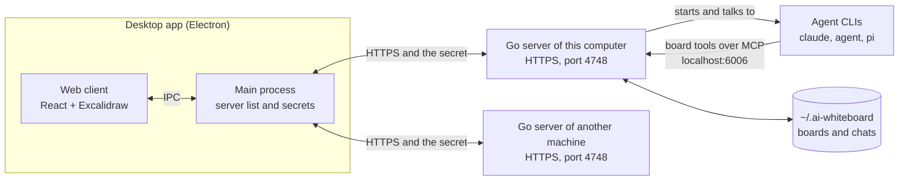

- The **server** is one Go program. It stores boards and chats and starts the agent processes. It
  serves no page: it has one API, over HTTPS behind a secret, for its clients.
- The **web client** is React with Excalidraw. It ships inside the **desktop app**, an Electron
  app that is the client of every server. The app's main process holds the list of servers with
  their secrets and keeps one connection to each; the page talks to the main process only. The
  app starts the server of your computer, or finds the one already running, and connects to it
  as to any other.
- Agents reach the board through **MCP tools** (read the board, get a picture, apply changes,
  delete elements, and more) on a second local port, 6006. The window that has the board open
  carries out the edits, which is how they become undo steps.

More in [docs/architecture.md](docs/architecture.md).

## Good to know

- **A board needs an open window to be changed.** Agents edit a board through the app window that
  has it open, so keep one open while an agent draws.
- **One instance per machine.** The MCP port is fixed at 6006, so a second AI Whiteboard server
  on the same machine does not start.
- **A server's secret is all or nothing.** Whoever has a server's secret reads and changes every
  chat, whiteboard and group on it. Every server that runs listens on its network, so keep its
  port inside a network you trust.
- **pi runs its tools without asking.** pi chats show no permission cards; only access to the
  app's own data folder is refused, and that guard is not a sandbox.

The full list, with the caps, is in [docs/limitations.md](docs/limitations.md).

## Documentation

- [docs/README.md](docs/README.md): the index of everything below
- [docs/architecture.md](docs/architecture.md): server, web client, desktop app, the connection
  between them, the MCP listener and the board tools, subagents, images
- [docs/prompt-library.md](docs/prompt-library.md): the prompt library in full
- [docs/remote-servers.md](docs/remote-servers.md): this computer and other servers as sections of
  the sidebar, building a server for another machine and using it from the app, and updating from
  the version before
- [docs/server-reference.md](docs/server-reference.md): server commands and flags
- [docs/troubleshooting.md](docs/troubleshooting.md): when an agent does not get its board tools,
  and when this computer's server does not start
- [docs/limitations.md](docs/limitations.md): limitations and caps
- [docs/development.md](docs/development.md): build, run and test while working on the app
- [AGENTS.md](AGENTS.md): for contributors, which tests to run and how to write them
